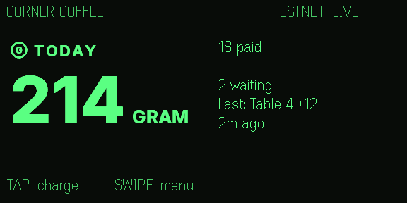
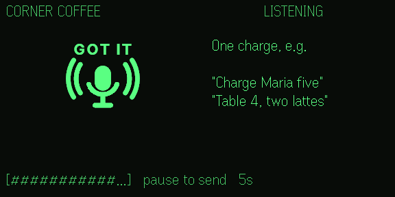
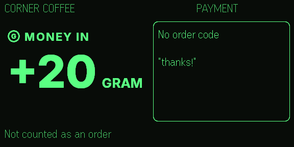
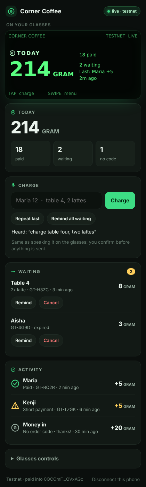
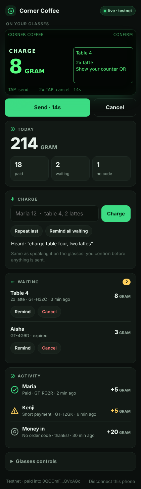
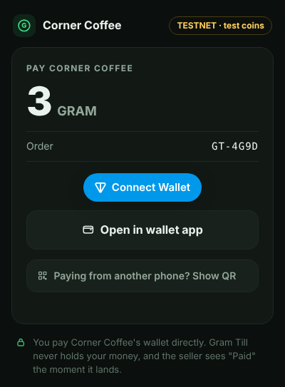

# Gram Till

**A hands-free till for people who get paid in Telegram, on Even Realities G2 glasses.**

A payment lands in your Gram Wallet and **PAID +12 GRAM · Maria** appears in your glasses. Say *"charge table four, two lattes"*, tap once, and the customer gets a payment request in Telegram. No unlocking your phone mid-task, no card terminal, and no trusting payment screenshots.

**Who it's for:** anyone, anywhere, who sells face to face and gets paid in Telegram, often with their hands full: coffee carts, food trucks, market stalls, barbers, tour guides, couriers, event and merch tables. Telegram's built-in Gram Wallet works across borders, so a seller can take payment from a local regular or a visitor from another country without a card machine, a local bank account or a currency exchange.

Built for **Heads Up: Even Realities Hackathon** (DoraHacks) · Tracks: **02 Crypto & DeFi** (Gram Wallet) + **01 Messaging & News** (Telegram) · Special: Best Telegram integration.

**Try it:** web https://gram-till.vercel.app · Telegram bot [@GramTillBot](https://t.me/GramTillBot) · glasses app https://gram-till.vercel.app/glasses/ · TON **testnet** (test coins only).

---

## ⚠️ What existed before Nov 23, 2026 (rules disclosure)

The rules ask entrants to say what existed before build week. Honest timeline:

- **Nov 22 (before kickoff):** idea research, `PLAN.md`, and a **first working prototype** of both parts, built Nov 22 and visible in the git history with timestamps:
  - `server/`: TON payment watcher, order matching, voice grammar, API, customer pay page, Telegram bot (50 unit tests)
  - `app/`: glasses app (till, payment takeover, voice to confirm card, menu, waiting list), tested in the official Even Hub simulator (14 unit tests)
- **Nov 23–29 (build week):** everything after the Nov 22 commits. See `git log` and the build-week log below. Highlights: Vercel deployment (Functions + Daemon + Neon Postgres), the live @GramTillBot, the first real testnet payment, and the fixes that real-world testing exposed.

**Open-source code and APIs used:** the official MIT-licensed [`even-realities/evenhub-templates`](https://github.com/even-realities/evenhub-templates) (`minimal` template, used as the starting structure of `app/`); the incoming-payment pattern from the official TON guidebook example ([`ton-org/docs-examples`](https://github.com/ton-org/docs-examples), invoice-based deposits); libraries listed in each `package.json` (`@evenrealities/even_hub_sdk`, `@ton/core`, `@ton/ton`, `@tonconnect/ui`, `grammy`, `hono`, `qrcode`). APIs: Toncenter, Telegram Bot API, Groq (Whisper speech-to-text).

---

## Screens (from the official Even Hub simulator)

Built for a glance mid-task: a dim status bar, a big **hero** number drawn as an image (bold type and icons the lens font can't show), a bright text column, and a dim hint row. Only the parts that change are redrawn, so countdowns and the live mic meter don't flicker. See every screen with sample data at `/glasses/?gallery` (tap = next).

| Till | Listening (live mic meter) | Voice → confirm (countdown) |
|---|---|---|
|  |  |  |
| **Payment lands** | **Short payment, reported honestly** | **Money without an order code** |
|  |  |  |

**Phone app** (inside the Even app): a live mirror of the lens with Send / Cancel when a charge waits for you, today's numbers, a typed charge box, waiting orders with Remind / Cancel, and the payment feed.

| Phone app | Confirm from the phone | Customer pay page |
|---|---|---|
|  |  |  |


## How it works

```
 G2 glasses ◄─BLE─► Even app (phone) ── WebView: app/  (Vite + TS + Even Hub SDK)
                                             │  HTTPS + SSE
                                             ▼
                     server/  (Node + TypeScript, Hono, Postgres or SQLite)
             ┌────────────────┬─────────────┴────────────┬───────────────────┐
             ▼                ▼                          ▼                   ▼
     Toncenter (read-only:   Telegram Bot API       Whisper STT          Pay page /pay/<code>
     watch the seller's      (seller setup, pay     (Groq; mic PCM →     (TON Connect for Gram Wallet,
     Gram Wallet)            requests, receipts)    text)                ton:// link, QR)
```

1. The seller sets up a shop in the Telegram bot and gives the wallet address they get paid into (their Gram Wallet).
2. On the glasses: **tap → speak → tap**, e.g. *"charge Maria twelve"*. The server turns speech into a **confirm card**. **Tap = send**, double-tap = cancel. Nothing is sent without that tap.
3. The customer gets **"Pay 15 GRAM · Order GT-7F3K"** in Telegram, with a Pay button. It opens the pay page, which offers TON Connect (Gram Wallet, Tonkeeper…), a `ton://` link and a QR. The order code goes into the transfer comment automatically.
4. The server watches the seller's wallet (read-only). When a transfer arrives whose comment carries the order code and whose amount covers it, the order is **paid**. The glasses show **PAID +12 GRAM · Maria**, the customer gets a receipt, and the seller gets a Telegram DM (so nothing is missed while the glasses app is closed).
5. Transfers without a known code show as **"MONEY IN · No order code"**, and short payments show as **"SHORT PAYMENT"** with what's still owed. They are never counted as paid. The pay page then asks only for the balance, and a top-up completes the order.

**Glasses controls:** tap, then just speak: it sends when you pause (or tap again to finish) · swipe = menu (repeat last, waiting orders, remind all, today's total) · double-tap = back / exit.

**Voice:** tap, speak, pause. Audio is kept from the instant of the tap (the first word isn't clipped), and the till sends automatically about 0.9 s after you stop talking. Detection adapts to background noise, so steady hum never counts as speech, and silence is never sent (Whisper invents text for silence).

**Voice grammar** (deterministic, no LLM: for money, predictable beats clever):
`charge <name | table N> <amount> [for [qty] <item>]` · `charge [qty] <item>` (price from `/menu`) · `remind <name | all>` · `cancel last` · `repeat` · `total`

## Safety

- **No custody, no keys.** Gram Till never holds funds or private keys and never signs a transaction. It reads the seller's own wallet and creates payment links. Customers approve every payment in their own wallet.
- **Testnet by default** (`NETWORK=testnet`). `NETWORK=mainnet` only *watches* a real Gram Wallet; there is nothing to send with.
- **One-tap confirm on the glasses**, previews that expire after 20 s and can be used only once, and a `MAX_CHARGE_GRAM` cap against misheard amounts.
- **Pairing codes** (6 digits, 10 minutes, single use) instead of passwords. Google sign-in doesn't work in the Even WebView.
- **Secrets stay on the server** (`.env`, never committed). The glasses app only talks to your server.
- The lens shows first names and order codes only.

## Works anywhere

- **Any country, any time zone:** each seller sets `/timezone` in the bot (e.g. `Europe/Berlin`, `Asia/Jakarta`, `America/Sao_Paulo`), so "today" totals follow their local midnight.
- **Any customer on Telegram:** payment requests, receipts and the pay page work wherever Telegram does. Pay with Telegram's Gram Wallet over TON Connect, any TON wallet via the `ton://` link, or by scanning the QR.
- **Speak your language:** set `/language es` (or `pt`, `fr`, `de`, `tr`, `id`, `ar`, `hi`, `ja`, `sw`… any language Whisper knows). Each command is transcribed in your language and translated to English **in parallel**. The safe English grammar parses the translation, and names and menu words are matched against what you actually said, so *"Cobra o João dois café com leite"* becomes **João · 2× café com leite**. Typed commands also understand the main verbs in Spanish, Portuguese, French, German, Italian, Turkish, Indonesian and Dutch. Non-Latin names (Олег, 健二) and accents (José = Jose) work.
- **Amounts are GRAM.** Say "twelve", "twelve fifty" (12.50) or "12,50". If you say a fiat currency ("12 dollars", "€5", "500 naira"), the till refuses instead of silently charging 12 GRAM.

---

## Live

**https://gram-till.vercel.app** (TON testnet) · bot **[@GramTillBot](https://t.me/GramTillBot)** · glasses app `https://gram-till.vercel.app/glasses/`.
Hosted on Vercel: the API runs as Vercel Functions, the wallet watcher as a Vercel Daemon, and both share a Neon Postgres database (`vercel.json`). Telegram runs in webhook mode.

**First real payment (Nov 24):** shop *Corner Coffee* charged 1 GRAM (order `GT-DWF7`) from the bot, a real testnet transfer carrying the code arrived, the watcher marked it paid, and the seller got the Telegram alert. Wallet on [testnet Tonviewer](https://testnet.tonviewer.com/0QCOmFghR0fSUPi9us4Lc4g-XdS8Z1TipSloAqopL-QVxAGc).

## Build-week log: what real testing found

Unit tests passed before any of these. Running on real accounts, the real chain and a real speech model is what surfaced them:

| Found live | Fix |
|---|---|
| Every watcher poll failed: Toncenter testnet *archive* nodes were down ("no workers available"), so a real payment went unseen | Ask regular nodes first, archive only as fallback; on first sight, catch up transfers that pay a currently-waiting order (unrelated history is still never replayed) |
| A short payment left the order stuck: the pay page kept asking for the full amount and a top-up was judged alone | Part-payments add up; page, QR and wallet links ask for the balance; seller alert says what's still owed |
| Whisper heard "Charge **table four**, two" for "Charge Abiola two": it copied example sentences from the speech hint | Hint with the seller's own words only (customers, recent order names, menu) |
| Whisper writes "table four" as "table **for**" | Number homophones mapped only where a number is the only sensible reading ("Charge Maria for two lattes" keeps its meaning) |
| "Table four, two lattes" on a shop with no menu became a 2 GRAM charge | Never drop an unpriced item; ask the seller to price it with `/menu` |
| Vercel couldn't type-check with TypeScript 7 | Server pinned to TypeScript 5.9 on Node 24 |

## Run it (Mac)

**Needs:** Node.js **22.5+** (`brew install node` or nodejs.org), and for Telegram buttons an https URL (a free Cloudflare tunnel works).

```bash
# 1. Server
cd server
npm install
cp .env.example .env        # fill in TELEGRAM_BOT_TOKEN, TONCENTER_API_KEY, GROQ_API_KEY
npm start                   # http://localhost:8787

# 2. (for Telegram Pay buttons) public https URL in another terminal:
brew install cloudflared && cloudflared tunnel --url http://localhost:8787
#    → copy the https://….trycloudflare.com URL into PUBLIC_URL in server/.env, restart the server

# 3. Glasses app
cd ../app
npm install
npm run dev                 # http://localhost:5173
npm run simulate            # opens the Even Hub simulator (uses your Mac's microphone)
```

Then in Telegram: open your bot → **/start** → shop name → paste your **testnet** wallet address → **/timezone** (your zone) → **/language** (if not English) → **/pair**. Enter the code in the simulator's phone panel (Server: `http://localhost:8787`).

**Testnet wallets and coins:** create two wallets in Tonkeeper (testnet mode) or wallet.ton.org, one for the seller and one for the customer, and get test GRAM from [@testgiver_ton_bot](https://t.me/testgiver_ton_bot). Get a Toncenter key from [@tonapibot](https://t.me/tonapibot).

**Debug the mic:** set `VOICE_DEBUG_DIR=./data` to save the last voice clip as `last-voice.wav`.

**No chain? UI-only mode:** set `DEV_SIMULATE=1` (testnet only). `POST /dev/pay/<order-code>` fakes a payment so you can work on the lens UI offline. Demo videos use real testnet transfers, not this.

**Seed a demo shop without Telegram:** `cd server && DB_PATH=./data/gramtill.db npm run seed -- <wallet-address>` prints a pairing code.

**Real glasses:** `npx evenhub qr --url http://<your-mac-ip>:5173`, scan it from the Even app (developer mode). Package with `cd app && npm run pack`: it builds against `https://gram-till.vercel.app` (override with `VITE_SERVER_URL=…`, and update `app.json` → `permissions` → `network.whitelist` to match) and writes `gram-till.ehpk`.

## Tests

```bash
cd server && npm test      # 88 tests: amounts, order matching, part-payments, TON parsing, watcher (incl. first-sight catch-up), voice grammar (8 languages, fiat refusal, homophones), STT flow, API, pay page
TEST_DATABASE_URL=postgres://… npm test   # same suite against Postgres (as deployed)
cd app && npm test         # 24 tests: lens state machine, payment takeover, gestures, end-of-speech detection on real speech
```

## Project layout

```
server/src/
  ton.ts         read-only TON: comment parsing, incoming-payment extraction, payment links
  watcher.ts     polls each seller's wallet; cursor-based, never replays history
  matcher.ts     payment → order decision (paid / underpaid / unmatched / duplicate…)
  processor.ts   applies a payment once (idempotent by tx hash) and publishes events
  voice.ts       deterministic voice grammar ("charge table four, two lattes")
  stt.ts         mic PCM → WAV → Whisper
  service.ts     till operations shared by the glasses API and the bot
  api.ts         REST + SSE + pay page + one-shot confirmations
  bot.ts         Telegram bot (grammY), webhook on Vercel / long polling locally
  store/         TillStore: Postgres (pg.ts, deployed) and SQLite (sqlite.ts, local; node:sqlite)
  app.ts         Vercel Functions entry · worker.ts  Vercel Daemon (wallet watcher) · local.ts  all-in-one local server
app/src/
  controller.ts  lens state machine (till, listening, confirm, payment takeover, menus)
  display.ts     Even Hub SDK wrapper (serialized bridge calls) + gesture normalisation
  format.ts      text for each lens card (576×288, ASCII only)
  companion.ts   phone screen: pairing + typed fallback
```

## License

MIT
